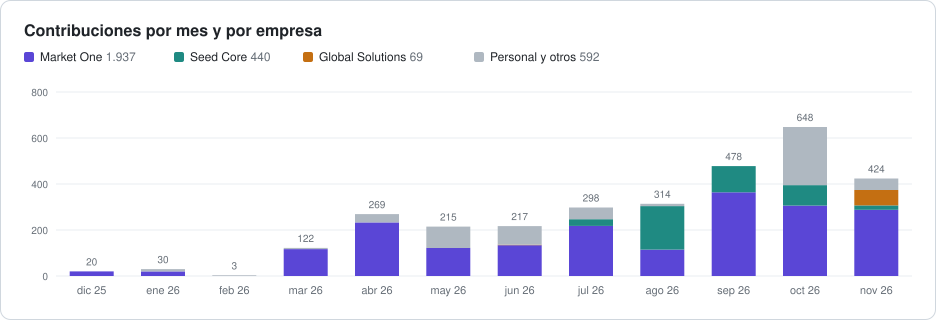

<h1 align="center">Hi, I'm Juan Pablo 👋</h1>

<b>Data Engineer</b> · Python · Google Cloud · Applied AI

  
   
  

---

I build data platforms and bring AI into production, turning data into value for business processes.

- **Data engineering** on Google Cloud and BigQuery: pipelines, data models and integrations across business systems.
- **Applied AI**: LLM-powered pipelines, agents and tooling that automate and improve operational processes.
- **Production-grade services**: scheduled jobs, APIs and orchestration on Cloud Run and Airflow.

---

  <picture>
    <source media="(prefers-color-scheme: dark)" srcset="metrics/stats-dark.svg">
    
  </picture>
  <picture>
    <source media="(prefers-color-scheme: dark)" srcset="metrics/languages-dark.svg">
    
  </picture>

  <picture>
    <source media="(prefers-color-scheme: dark)" srcset="metrics/monthly-dark.svg">
    
  </picture>

Includes activity in private and organization repositories (repository names are never shown). Updated daily by a GitHub Action.
