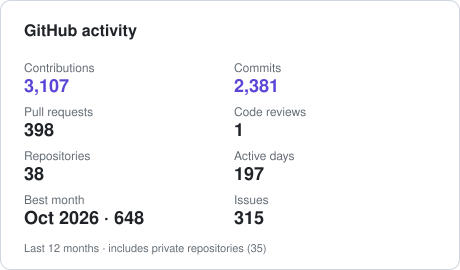
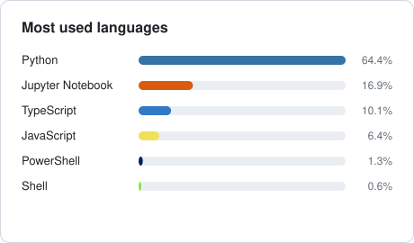

<h1 align="center">Hola, soy Juan Pablo 👋</h1>

<b>Data Engineer</b> en Market One · Python · GCP · BigQuery · IA aplicada

---

### Qué hago

- Construyo **pipelines y modelos de datos** sobre Google Cloud / BigQuery.
- Integro sistemas de la empresa (ERP, CRM, gestión de proyectos) y automatizo procesos con **jobs en Cloud Run**.
- Desarrollo **servidores MCP y herramientas con IA** para que los equipos consulten sus datos en lenguaje natural.
- Antes: scraping, modelos de ML (OCR, churn, series de tiempo) y APIs con FastAPI y Django.

### Stack

  

### Actividad

  <picture>
    <source media="(prefers-color-scheme: dark)" srcset="metrics/stats-dark.svg">
    
  </picture>
  <picture>
    <source media="(prefers-color-scheme: dark)" srcset="metrics/languages-dark.svg">
    
  </picture>

<picture>
  <source media="(prefers-color-scheme: dark)" srcset="metrics/monthly-dark.svg">
  
</picture>

Incluye la actividad en repos privados y de organizaciones (sin exponer nombres de repos). Se actualiza todos los días con una GitHub Action.

### Proyectos públicos

| Proyecto | Qué es |
|---|---|
| [portfolio](https://github.com/juampa95/portfolio) | Portfolio full-stack: React + anime.js, asistente IA con command palette y backend Express en Cloud Run. |
| [web_scraping](https://github.com/juampa95/web_scraping) | Scraper diario de precios en todas las sucursales del país, automatizado con AWS Lambda y S3. |
| [cnn-ocr](https://github.com/juampa95/cnn-ocr) | Red neuronal CNN con arquitectura SSD para reconocimiento de caracteres. |
| [scraping_licitaciones_gob](https://github.com/juampa95/scraping_licitaciones_gob) | Recolección de licitaciones públicas del sitio COMPRAR del gobierno argentino. |
